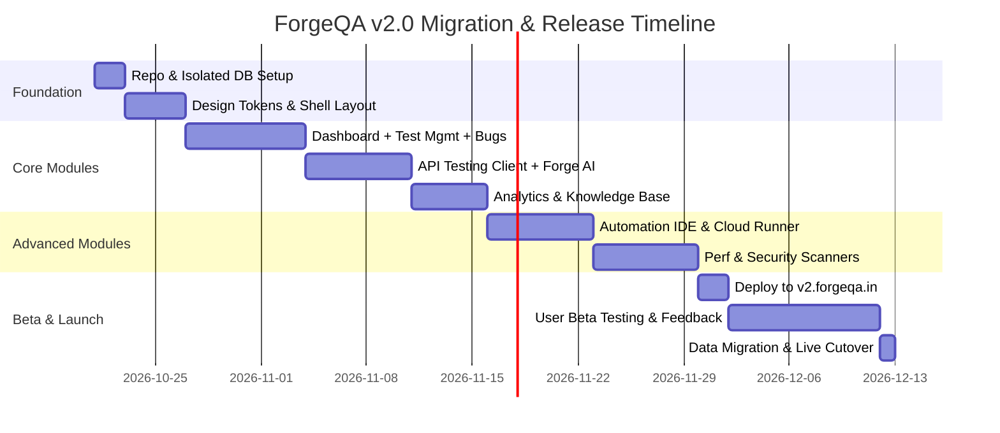

# 🚀 ForgeQA v2.0 — Safe Release & Architecture Migration Plan
> **Document Version:** 1.0.0  
> **Target Release:** ForgeQA v2.0 (Next-Gen AI Testing Suite)  
> **Primary Directive:** Build, test, and release ForgeQA v2.0 in complete isolation with **zero disruption and zero downtime** to the current live production platform (`forgeqa.in`).

---

## 1. Executive Summary

ForgeQA v2.0 transforms the platform from a test case and PRD assistant into an **All-in-One QA Command Center** covering 11 interconnected modules (Test Management, Bug Tracking, API Testing, Playwright Automation IDE, Performance Load Testing, OWASP Security Scanner, Cross-Browser Testing, QA Analytics, Knowledge Base, AI Assistant, and Integrations).

To ensure current users and existing revenue streams are protected, development and deployment will follow an **Isolated Parallel Track Strategy**.

```
+---------------------------------------------------------------------------------+
|                               Live Traffic                                      |
|                                     │                                           |
|                     ┌───────────────┴───────────────┐                           |
|                     ▼                               ▼                           |
|           [ forgeqa.in (v1) ]            [ v2.forgeqa.in (Staging) ]            |
|          Live Production Build              Isolated v2 Sandbox                 |
|             (Untouched)                     (Safe Dev & Beta)                   |
|                     │                               │                           |
|             ┌───────┴───────┐               ┌───────┴───────┐                   |
|             ▼               ▼               ▼               ▼                   |
|       forgeqa-prod      Railway v1    forgeqa_v2_stage   Railway v2             |
|        MongoDB           Backend          MongoDB         Backend               |
+---------------------------------------------------------------------------------+
```

---

## 2. Workspace & Folder Isolation

Your existing local project will remain untouched to serve as the stable hotfix reference.

### Local Directory Structure
```text
D:\New folder\
├── forgeqa.in-main/             <-- CURRENT LIVE BUILD (Do not touch)
│   ├── public/mockups/          <-- Design mockups stored here
│   └── ...
│
└── forgeqa-v2/                  <-- NEW VERSION REPOSITORY (Active Development)
    ├── client/                  <-- React 18 / Vite / Tailwind
    │   ├── src/
    │   └── public/mockups/      <-- Copied high-fidelity Figma mockups
    ├── server/                  <-- Node.js / Express API
    ├── .env                     <-- Isolated local environment
    └── README.md
```

### Local Dev Port Allocation (No Port Collisions)
| Service | ForgeQA v1 (Current) | ForgeQA v2 (New Build) |
|---|---|---|
| **Frontend (Vite Dev)** | `http://localhost:5173` | `http://localhost:5174` |
| **Backend API (Node)** | `http://localhost:5000` | `http://localhost:5001` |
| **Local MongoDB** | `mongodb://localhost:27017/forgeqa` | `mongodb://localhost:27017/forgeqa_v2` |

---

## 3. GitHub & Repository Strategy

### Recommended: Dedicated Repository (`forgeqa-v2`)
* **Repository Name:** `github.com/jagath132/forgeqa-v2`
* **Default Branch:** `main`

#### Why a separate repo is mandatory:
1. **Zero Deployment Accidents:** Vercel and Railway webhooks for v1 will never accidentally trigger from a v2 commit.
2. **Clean Commit History:** Dedicated commit tree for v2 modular architecture without legacy baggage.
3. **Independent CI/CD:** Clean workflows for testing, linting, and automated cloud runners.

---

## 4. Database & Storage Isolation Matrix

> [!CAUTION]
> **Never point v2 to the v1 production database!** Schema changes, new enum fields, and bug tracker models will invalidate v1 document schemas.

| Environment Variable | ForgeQA v1 (Production) | ForgeQA v2 (Staging / Dev) | Isolation Purpose |
|---|---|---|---|
| `MONGODB_URI` | `.../forgeqa_prod?ssl=true` | `.../forgeqa_v2_staging?ssl=true` | Independent collections & indexes |
| `JWT_SECRET` | `prod_jwt_secret_99` | `v2_stage_jwt_secret_44` | Tokens cannot be forged across versions |
| `STRIPE_SECRET_KEY` | `sk_live_...` | `sk_test_...` | Prevents test subscriptions from billing real cards |
| `STRIPE_WEBHOOK_SECRET`| `whsec_live_...` | `whsec_test_...` | Independent billing webhook handlers |
| `STORAGE_BUCKET_NAME` | `forgeqa-prod-attachments` | `forgeqa-v2-dev-attachments` | Isolated screenshot & video storage |
| `CLIENT_URL` | `https://forgeqa.in` | `https://v2.forgeqa.in` | CORS origin safety |

---

## 5. Cloud Hosting & Domain Routing Strategy

### A. Frontend (Vercel)
1. Link the new GitHub repo `forgeqa-v2` as a **New Project** in Vercel.
2. Add a custom subdomain in Vercel DNS:
   - **Staging / Beta:** `v2.forgeqa.in` (points to `forgeqa-v2`)
   - **Production:** `forgeqa.in` (remains pointed to `forgeqa.in-main` until live launch)

### B. Backend (Railway)
1. Create a new service or isolated environment in Railway: `forgeqa-v2-backend`.
2. Assign custom domain: `api-v2.forgeqa.in`.
3. Provide isolated environment variables from Section 4.

---

## 6. The 11 Core Modules in ForgeQA v2

| # | Module | Status in v1 | Plan for v2 | Figma Mockup Reference |
|---|---|---|---|---|
| **01** | **QA Command Center** | Basic Overview | Executive Health Score (87%), Sprint timeline, AI risk radar | `01_command_center.jpg` |
| **02** | **Bug Tracker & Defect Mgmt** | None | Kanban board (New, In Progress, Fixed, Closed), AI Duplicate detector | `02_bug_tracker.jpg` |
| **03** | **API Testing Client** | None | 3-panel Postman alternative, JSON syntax editor, latency breakdown, assertions | `03_api_testing.jpg` |
| **04** | **Test Management** | Partial | Suite tree explorer, execution pills, step-by-step drawer with linked bugs | `04_test_management.jpg` |
| **05** | **Forge AI Assistant** | Basic prompt | Dedicated chat copilot, 1-click test suite injection, RCA engine | `05_ai_assistant.jpg` |
| **06** | **QA Analytics** | Minimal | 30-day quality trends, defect density, flaky test tracker, severity donut | `06_analytics.jpg` |
| **07** | **Automation IDE** | Basic script list | In-browser Monaco editor (Playwright/TS), live cloud terminal, video scrubber | `07_automation_testing.jpg` |
| **08** | **Performance Testing** | None | Real-time dual-axis VU ramp-up vs P95 latency, RPS counter, regional latency | `08_performance_testing.jpg` |
| **09** | **Security & OWASP Scanner**| None | Posture score (78/100), CVSS finding cards, AI code remediation diff viewer | `09_security_testing.jpg` |
| **10** | **Cross-Browser & Visual Diff**| None | Pixel-by-pixel diff overlay, layout shift detection, real device selector | `10_cross_browser.jpg` |
| **11** | **PRD & Knowledge Base** | Standalone PRD | Notion-style editor, live Traceability Matrix (AC -> TC), gap analyzer | `11_knowledge_base.jpg` |

---

## 7. Phased Implementation Roadmap



### Milestone 1: Workspace & Skeleton (Week 1)
- [ ] Initialize `forgeqa-v2` directory and GitHub repository.
- [ ] Setup Obsidian Charcoal (`#0D0F14`) theme tokens in Tailwind.
- [ ] Create shared layout: Collapsible left sidebar, top global bar, notification center.

### Milestone 2: Core QA Trio (Weeks 2–3)
- [ ] Build **QA Command Center** (`01_command_center.jpg`).
- [ ] Build **Test Management & Execution** (`04_test_management.jpg`).
- [ ] Build **Bug Tracker with AI Deduplication** (`02_bug_tracker.jpg`).

### Milestone 3: API & AI Assistant (Weeks 4–5)
- [ ] Build **API Testing Client** (`03_api_testing.jpg`) with proxy runner backend.
- [ ] Build **Forge AI Assistant** (`05_ai_assistant.jpg`) with suite-injection hooks.
- [ ] Build **PRD & Requirements Traceability Matrix** (`11_knowledge_base.jpg`).

### Milestone 4: Execution Infrastructure & Scanners (Weeks 6–7)
- [ ] Build **Automation Testing IDE** (`07_automation_testing.jpg`).
- [ ] Build **Performance Load Testing** (`08_performance_testing.jpg`).
- [ ] Build **Security OWASP Scanner** (`09_security_testing.jpg`).
- [ ] Build **Cross-Browser Visual Diff** (`10_cross_browser.jpg`).

### Milestone 5: Staging Beta (Week 8)
- [ ] Deploy to `v2.forgeqa.in`.
- [ ] Perform end-to-end integration tests on all 11 modules.
- [ ] Conduct closed beta with select testers.

---

## 8. Zero-Downtime Live Cutover Protocol

When ForgeQA v2.0 is validated and ready for the public:

```
Step 1: Data Migration
Migrate existing v1 users, organizations, and test cases into v2 DB via automated script.

Step 2: DNS Switch in Vercel
In Vercel Domain Settings, reassign "forgeqa.in" from forgeqa-v1 to forgeqa-v2.
(Takes ~30 seconds to propagate with 0 downtime).

Step 3: Preserve Legacy Fallback
Assign "legacy.forgeqa.in" to forgeqa-v1 for 30 days so users can access old drafts if needed.

Step 4: Live Verification
Perform smoke test on auth, billing, and test creation on live forgeqa.in.
```

---

## 9. Rollback Plan

If any critical issue arises during cutover:
1. Re-point `forgeqa.in` in Vercel back to `forgeqa.in-main` (instant 10-second rollback).
2. v1 database was never modified, so data integrity is guaranteed 100%.
3. Debug v2 on `v2.forgeqa.in` without customer impact.
